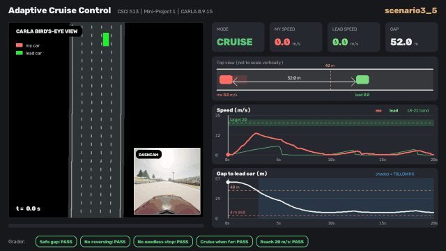

# Adaptive Cruise Control in CARLA 🚗

This is my adaptive cruise control (ACC) project for CSCI 513. My car drives in CARLA behind a lead car. It tries to cruise at 20 m/s, and when it gets close to the lead car it slows down so it never crashes into it.

All 15 test scenarios pass all 5 safety checks. 



## What's going on

Every 0.1 s the controller gets three numbers:

- my current speed
- the speed I want to go (20 m/s)
- the distance to the car in front (`inf` if nobody is in my lane)

It sends back two things: a gas/brake command between -10 and 10, and a mode, which is either `CRUISING` or `FOLLOWING`.

## How my controller works

The code is in [`mp1_controller/controller.py`](mp1_controller/controller.py). The idea is pretty simple:

1. **Guess how fast the lead car is going.** The simulator doesn't tell me the lead car's speed, so I work it out from how much the gap changed since the last step, plus my own speed. I smooth that guess a bit so it doesn't jump around.
2. **Work out a "safe speed".** This is the fastest I can go and still stop in time if the lead car slams on its brakes. It assumes I react in about 0.5 s, brake at about 3.5 m/s², and always keep an 8 m buffer. If the lead car is moving, it gets some credit for the distance it will cover while it stops too.
3. **Pick a target.** I aim for whichever is lower: the safe speed or 20 m/s.
4. **Gas or brake.** The command is proportional to how far I am from the target. Braking is a bit stronger than speeding up (gain 8 vs 5), and the result is clamped to [-10, 10].
5. **Pick a mode.** If the lead car is more than 40 m away or out of the lane, the mode is `CRUISING`. Otherwise it's `FOLLOWING`.

That's it: no fancy PID tuning or MPC, just "never go faster than you can safely stop."

## How it gets checked

The evaluator ([`mp1_evaluation/`](mp1_evaluation/)) reads the logs from each run and checks 5 rules using Signal Temporal Logic (the [RTAMT](https://github.com/nickovic/rtamt) library):

| Rule | In plain English |
|---|---|
| `safeFollowing` | Always stay at least 4 m from the lead car (measured center to center, so 4 m is basically touching) |
| `forwardProgress` | Never roll backwards |
| `dontStopUnlessLeadStops` | Don't just stop in the road while the lead car is still moving |
| `notFollowWhenFarAway` | If the lead car is more than 40 m away, switch to `CRUISING` within 2 s |
| `reachTargetWhenNotFollowing` | When cruising, get within 2 m/s of 20 m/s within 6 s |

### My results

| | Safe gap | No reversing | No needless stop | Cruise when far | Reach 20 m/s |
|---|---|---|---|---|---|
| scenario1_0 – 1_4 (5 runs) | ✅ | ✅ | ✅ | ✅ | ✅ |
| scenario3_0 – 3_9 (10 runs) | ✅ | ✅ | ✅ | ✅ | ✅ |
| **Fraction satisfied** | **1.00** | **1.00** | **1.00** | **1.00** | **1.00** |

Want to see them? There's a video and a GIF of every scenario in [`mp1-acc-showcase/`](mp1-acc-showcase/). [`all_scenarios.mp4`](mp1-acc-showcase/videos/all_scenarios.mp4) plays them all back to back. My car is red and the lead car is green.

## Folder structure

```
csci513-project/
├── mp1_controller/        # 👈 my controller lives here
│   └── controller.py
├── mp1_simulator/         # talks to CARLA, spawns the cars, runs each scenario, writes logs
├── mp1_evaluation/        # checks the logs against the 5 STL rules
├── test_data/             # 15 scenario files (start positions + what the lead car does)
├── mp1-acc-showcase/      # results: README, videos/, gifs/, copy of the controller
├── record_showcase.py     # runs every scenario and records a bird's-eye view
├── make_showcase.py       # turns the recordings into videos/GIFs with speed + gap graphs
├── imgs/                  # screenshots for the HPC guide
├── HPC-Instructions.md    # how to run on USC's HPC if you don't have a GPU
├── Carla.Dockerfile       # Docker setup for the CARLA server
├── Carla.def              # same thing as an Apptainer/Singularity image
├── Makefile               # shortcuts: make build / run-carla / stop
└── setup.py, setup.cfg    # Python package setup
```

