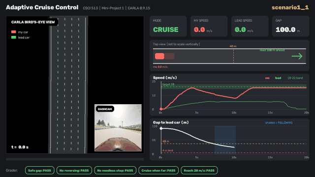
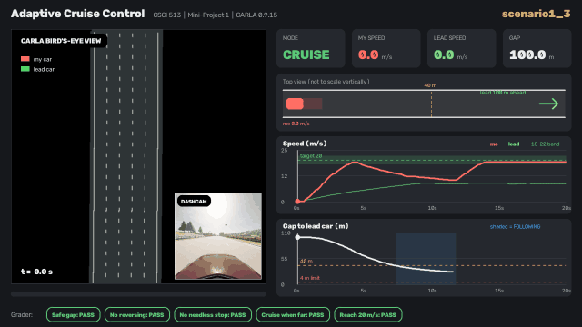
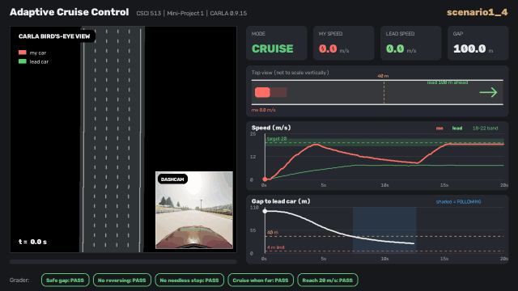
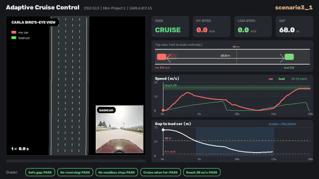
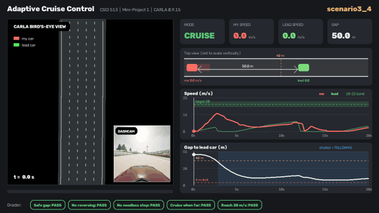
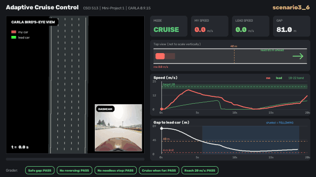
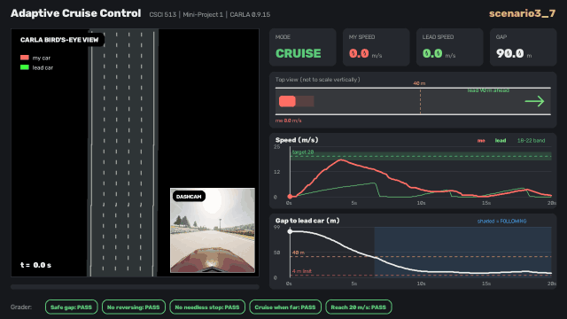

# Adaptive Cruise Control in CARLA (CSCI 513 Mini-Project 1)

An adaptive cruise controller for CARLA 0.9.15. Each step it works out the fastest speed
from which the car could still stop behind the lead car (even if the lead brakes hard),
aims for that or 20 m/s (whichever is lower), and sets throttle/brake from the speed error.
It reports `CRUISING` when the lead car is more than 40 m away or out of the lane, otherwise `FOLLOWING`.

## Results

| Scenario | Safe gap | No reversing | No needless stop | Cruise when far | Reach 20 m/s |
|---|---|---|---|---|---|
| scenario1_0 | PASS | PASS | PASS | PASS | PASS |
| scenario1_1 | PASS | PASS | PASS | PASS | PASS |
| scenario1_2 | PASS | PASS | PASS | PASS | PASS |
| scenario1_3 | PASS | PASS | PASS | PASS | PASS |
| scenario1_4 | PASS | PASS | PASS | PASS | PASS |
| scenario3_0 | PASS | PASS | PASS | PASS | PASS |
| scenario3_1 | PASS | PASS | PASS | PASS | PASS |
| scenario3_2 | PASS | PASS | PASS | PASS | PASS |
| scenario3_3 | PASS | PASS | PASS | PASS | PASS |
| scenario3_4 | PASS | PASS | PASS | PASS | PASS |
| scenario3_5 | PASS | PASS | PASS | PASS | PASS |
| scenario3_6 | PASS | PASS | PASS | PASS | PASS |
| scenario3_7 | PASS | PASS | PASS | PASS | PASS |
| scenario3_8 | PASS | PASS | PASS | PASS | PASS |
| scenario3_9 | PASS | PASS | PASS | PASS | PASS |
| **Fraction satisfied** | **1.00** | **1.00** | **1.00** | **1.00** | **1.00** |

## Scenario videos

Each video shows the CARLA bird's-eye view (my car red, lead car green) with the dashcam in the corner,
live speed/gap readouts, a simple lane sketch, speed and gap graphs, and the grader's verdict
for each rule. Full-quality videos are in [`videos/`](videos/);
all scenarios back to back: [`videos/all_scenarios.mp4`](videos/all_scenarios.mp4).

### scenario1_0

### scenario1_1

### scenario1_2

### scenario1_3

### scenario1_4

### scenario3_0

### scenario3_1

### scenario3_2

### scenario3_3

### scenario3_4

### scenario3_5

### scenario3_6

### scenario3_7

### scenario3_8

### scenario3_9

## Files

- `controller.py`: the controller (the file submitted for grading)
- `logs/`: raw traces from the simulator (one CSV per scenario)
- `videos/`, `gifs/`: HUD videos and previews
